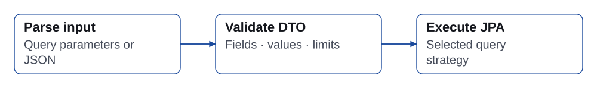

# Basic Usage

This complete search example targets the `1.1.3` starter. Put each public class in its own file under the application's component/entity scan. Configure a datasource and an ordinary `@SpringBootApplication` as usual. Field names are validated at runtime; string-based field paths are not checked by the Java compiler.

## Entity

```java
import jakarta.persistence.Entity;
import jakarta.persistence.GeneratedValue;
import jakarta.persistence.Id;
import java.time.Instant;

@Entity
public class Post {
    @Id @GeneratedValue
    private Long id;
    private String title;
    private String status;
    private Long viewCount;
    private Instant createdAt;

    public Long getId() { return id; }
    public String getTitle() { return title; }
    public String getStatus() { return status; }
    public Long getViewCount() { return viewCount; }
    public Instant getCreatedAt() { return createdAt; }
}
```

The example is a read model; add the constructors, mutation methods and auditing needed by your application. The default no-argument constructor satisfies JPA.

## Search DTO

A search DTO lists fields clients may filter or sort. Supply JavaBean getters, including for inherited searchable properties. The DTO is a validation schema; clients do not submit a populated DTO instance.

```java
import dev.simplecore.searchable.core.annotation.SearchableField;
import java.time.Instant;
import static dev.simplecore.searchable.core.condition.operator.SearchOperator.*;

public class PostSearchDTO {
    @SearchableField(operators = {EQUALS, GREATER_THAN}, sortable = true)
    private Long id;
    @SearchableField(operators = {EQUALS, CONTAINS, STARTS_WITH}, sortable = true)
    private String title;
    @SearchableField(operators = {EQUALS, IN})
    private String status;
    @SearchableField(operators = {GREATER_THAN_OR_EQUAL_TO, BETWEEN}, sortable = true)
    private Long viewCount;
    @SearchableField(operators = {BETWEEN, GREATER_THAN, LESS_THAN}, sortable = true)
    private Instant createdAt;

    public Long getId() { return id; }
    public String getTitle() { return title; }
    public String getStatus() { return status; }
    public Long getViewCount() { return viewCount; }
    public Instant getCreatedAt() { return createdAt; }
}
```

An empty `operators` declaration permits all operators, subject to value/type checks. Prefer explicit operators for a public endpoint. `sortable` defaults to false. `entityField` maps a DTO alias to an entity property path; `sortField` overrides only its sorting path. See [Search Operators](/en/search-operators.md).

## Repository and service

```java
import org.springframework.data.jpa.repository.JpaRepository;
import org.springframework.data.jpa.repository.JpaSpecificationExecutor;

public interface PostRepository extends JpaRepository<Post, Long>, JpaSpecificationExecutor<Post> {
}
```

```java
import dev.simplecore.searchable.core.service.DefaultSearchableService;
import jakarta.persistence.EntityManager;
import org.springframework.stereotype.Service;

@Service
public class PostService extends DefaultSearchableService<Post, Long> {
    public PostService(PostRepository repository, EntityManager entityManager) {
        super(repository, entityManager);
    }
}
```

Both repository interfaces are required. If the service already extends another base class, use `SearchableServiceSupport` and `SearchableServiceDelegate`; see [Advanced Features](/en/advanced-features.md).

## GET and POST controllers

```java
import dev.simplecore.searchable.core.condition.SearchCondition;
import dev.simplecore.searchable.core.condition.parser.SearchableParamsParser;
import dev.simplecore.searchable.openapi.annotation.SearchableParams;
import java.util.Map;
import org.springframework.data.domain.Page;
import org.springframework.web.bind.annotation.*;

@RestController
@RequestMapping("/api/posts")
public class PostController {
    private final PostService service;
    public PostController(PostService service) { this.service = service; }

    @GetMapping("/search")
    public Page<Post> search(@RequestParam @SearchableParams(PostSearchDTO.class) Map<String, String> params) {
        return service.findAllWithSearch(new SearchableParamsParser<>(PostSearchDTO.class).convert(params));
    }

    @PostMapping("/search")
    public Page<Post> search(@RequestBody SearchCondition<PostSearchDTO> condition) {
        return service.findAllWithSearch(condition);
    }
}
```

`@SearchableParams` documents the map; the explicit parser call performs the conversion. Keep the DTO type argument on a JSON body. Jackson 2 and Jackson 3 use the same DTO validation and mapping rules. Do not bind an untyped condition from untrusted input.

```bash
curl --get 'http://localhost:8080/api/posts/search' \
  --data-urlencode 'title.contains=Spring' \
  --data-urlencode 'sort=createdAt.desc,id.asc' \
  --data-urlencode 'page=0' \
  --data-urlencode 'size=20'
```

GET conditions are ANDed. The sort syntax is `field.asc,otherField.desc`; `field,desc` is invalid. Use a JSON body for OR or nested groups:

```json
{
  "conditions": [
    {"field": "title", "searchOperator": "contains", "value": "Spring"},
    {"operator": "and", "field": "status", "searchOperator": "in", "value": ["PUBLISHED", "DRAFT"]}
  ],
  "sort": {"orders": [{"field": "createdAt", "direction": "desc"}]},
  "page": 0,
  "size": 20
}
```

The `operator` on a node connects that node to the accumulated result. The first node in each list has no preceding result. Values for BETWEEN use `value` and `value2`; IN uses an array. `entityField` and `fetchFields` are not client-controlled mapping/fetch options.

## Server-side groups

The following condition means `status = PUBLISHED AND (title contains Spring OR title contains JPA)`. The inner group remains grouped when combined with the outer filter.

```java
import dev.simplecore.searchable.core.condition.SearchCondition;
import dev.simplecore.searchable.core.condition.SearchConditionBuilder;

SearchCondition<PostSearchDTO> condition = SearchConditionBuilder.create(PostSearchDTO.class)
        .where(w -> w.equals("status", "PUBLISHED"))
        .and(g -> g.contains("title", "Spring").orContains("title", "JPA"))
        .sort(s -> s.desc("createdAt").asc("id"))
        .page(0).size(20)
        .build();
```

Within a list, connectors are evaluated left to right, rather than by SQL's implicit AND precedence. Use an explicit nested group for each intended pair of parentheses. `SearchConditionBuilder.from(existing, DTO.class)` copies the structure before extending it.

## Pagination and responses

Omitting pagination uses page 0 and the configured default size (20). Page size must be positive and no greater than the configured maximum (1,000 by default). The service adds primary-key ordering when necessary to break ties. Page content and total count refer to matching root entities, not joined child rows.

The service returns Spring Data `Page<T>`. Its HTTP representation depends on the application's Spring Data/Jackson configuration. For a stable public response contract, map it to your own response DTO. Returning JPA entities directly can expose fields and traverse lazy relationships; choose a response model deliberately.



## Error and authorization boundaries

DTO-aware input rejects unapproved fields/operators/sorts and invalid values. `SearchableParseException` and `SearchableValidationException` are runtime exceptions derived from `SearchableException`. Map these to a suitable client error in your controller advice. Jackson body conversion normally reports invalid JSON requests through Spring MVC's message-conversion error handling.

The library does not add tenant or row permissions. Add mandatory scope on the server after parsing, and keep it outside client-controlled OR groups. See [Advanced Features](/en/advanced-features.md) for safe group composition and write semantics.
