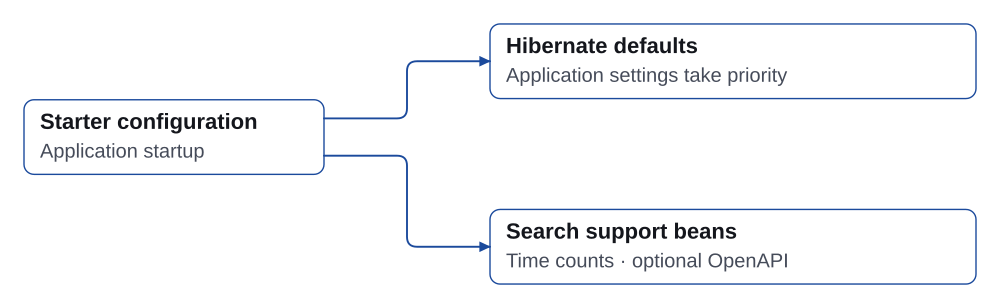

# Auto Configuration

The starter registers JPA defaults before Hibernate's auto-configuration and an OpenAPI operation customizer in a servlet application. All settings below are optional. This page describes `2.0.0`.

## Configuration example

```yaml
searchable:
  max-page-size: 1000
  default-page-size: 20
  swagger:
    enabled: true
  date-time:
    default-timezone: Asia/Seoul
  hibernate:
    auto-optimization: true
    auto-fetch-collections: true
    default-batch-fetch-size: 100
    jdbc-batch-size: 1000
    batch-versioned-data: true
    order-inserts: true
    order-updates: true
    in-clause-parameter-padding: true
```

`Asia/Seoul` is an example, not the default timezone. Unset timezone settings resolve as described below.

## Properties and boundaries

| Property under `searchable` | Default | Behavior |
| --- | --- | --- |
| `default-page-size` | 20 | Used when the condition omits size; positive and no greater than the maximum |
| `max-page-size` | 1000 | Maximum executed page size; positive |
| `swagger.enabled` | true | Enables this library's operation customizer, not access control for Swagger endpoints |
| `date-time.default-timezone` | unset | First choice for interpreting timezone-less input |
| `hibernate.auto-optimization` | true | Adds the six Hibernate defaults in the next table |
| `hibernate.auto-fetch-collections` | true | Includes automatically detected to-one paths through direct collections; false disables that extra detection |
| `hibernate.default-batch-fetch-size` | 100 | Positive Hibernate lazy-load batch size |
| `hibernate.jdbc-batch-size` | 1000 | Positive Hibernate JDBC statement batch size |
| `hibernate.batch-versioned-data` | true | Passes Hibernate's versioned-data batching setting |
| `hibernate.order-inserts` | true | Orders inserts for JDBC batching |
| `hibernate.order-updates` | true | Orders updates for JDBC batching |
| `hibernate.in-clause-parameter-padding` | true | Pads eligible IN parameter lists to improve query plan reuse |

The collection option preserves existing automatic loading by default. Explicit server-side `fetchFields` still work when it is false. It does not change JPA `EAGER` mappings or disable ordinary lazy loading.

## Hibernate defaults and precedence

| Library property suffix | `spring.jpa.properties` key |
| --- | --- |
| `default-batch-fetch-size` | `hibernate.default_batch_fetch_size` |
| `jdbc-batch-size` | `hibernate.jdbc.batch_size` |
| `batch-versioned-data` | `hibernate.jdbc.batch_versioned_data` |
| `order-inserts` | `hibernate.order_inserts` |
| `order-updates` | `hibernate.order_updates` |
| `in-clause-parameter-padding` | `hibernate.query.in_clause_parameter_padding` |

These values enter the environment at the lowest priority. Explicit application, system and environment settings take precedence. Setting `auto-optimization: false` disables these defaults; it leaves validation, page limits and timezone configuration active.

The starter **does not set** `hibernate.connection.provider_disables_autocommit`. That property asserts a datasource guarantee. Incorrectly forcing it to true can commit writes that should roll back. Datasource auto-commit and transaction configuration remain the application's responsibility.

JDBC statement batching and the service's 200-entity write chunks are different controls. Changing `jdbc-batch-size` does not change the service chunk size or the transaction boundary.

## Request limits

| Input | Limit |
| --- | --- |
| Page number | Zero or greater |
| Page size | 1 through configured `max-page-size` |
| Offset | `page * size <= 2,147,483,647` |
| Condition/group nodes | 1,000 total |
| Group depth | 32 nested levels below the root list |
| Collection values, including IN | 1,000 per condition |
| Sort fields | 16 |

Structural checks apply to parsed JSON, builders and conditions passed to query construction. DTO-aware entry points also validate field permissions, operators, sort permissions and values. A manually constructed `SearchCondition` is trusted server code; it is not a replacement for DTO validation on untrusted input. HTTP body size, string lengths, request rate and database query timeout remain application-level controls.

Page size defaults and maxima are evaluated against the active persistence unit. Without the starter, equivalent EntityManagerFactory properties are `searchable.default_page_size`, `searchable.max_page_size` and `searchable.auto_fetch_collections`. The starter exposes them via `spring.jpa.properties`. Configure custom persistence units explicitly. Keep their page settings positive and the default no greater than the maximum.

## Timezone resolution

1. Valid `searchable.date-time.default-timezone`.
2. A `ZoneId` bean named `applicationZoneId`.
3. Valid `spring.jackson.time-zone`.
4. UTC.

Invalid explicit zone IDs are logged and fall through to the next choice. An offset supplied in a search value remains meaningful; timezone-less temporal values and date-only BETWEEN boundaries use the resolved application zone. The parser's zone holder is process-wide, so multiple application contexts in one JVM should use the same zone. Page limits are not global.

## Registered beans

`TimeBucketCounter` is registered when no application bean of that type exists. `searchConditionCustomizer` is registered by name when Swagger customization is enabled, Spring MVC has a `RequestMappingHandlerMapping`, the relevant SpringDoc classes exist and the application is servlet-based. An application bean with that name overrides it.



See [OpenAPI Integration](/en/openapi-integration.md) for grouped APIs and [Relationships](/en/relationship-and-two-phase-query.md) for fetch behavior.
