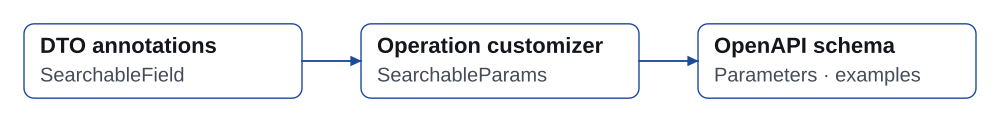

# OpenAPI Integration

The starter includes the OpenAPI module and SpringDoc 2.10.0 for the Boot 3 line. The Boot 4 line uses SpringDoc 3.x. Keep SpringDoc on the line compatible with the host application's Boot version.

## GET documentation

```java
import dev.simplecore.searchable.openapi.annotation.SearchableParams;
import java.util.Map;
import org.springframework.web.bind.annotation.RequestParam;

// On a controller method parameter:
// @RequestParam @SearchableParams(PostSearchDTO.class) Map<String, String> params
```

For every searchable DTO field, `ParameterGenerator` adds query parameters for its allowed operators. An empty operator declaration now documents all operators rather than hiding the field's operations. Inherited searchable fields are included. Sortable fields appear in the sort description, and page/size parameters are added. The annotation only documents input; call `SearchableParamsParser.convert` as shown in [Basic Usage](./basic-usage.md).

## POST documentation

Use `@RequestBody SearchCondition<PostSearchDTO>`. The customizer resolves the type argument, emits the condition/group schema and a JSON example. A raw `SearchCondition`, wildcard or unresolved generic type may not provide enough information for generation. Declare a concrete DTO type at the controller boundary.

Example generation chooses a searchable field and an allowed operator, uses DTO schema examples when available, and converts values to the target type. A generation error is logged and may produce an empty example; it does not grant runtime access to an unapproved field. Inspect generated examples when using custom validation constraints.

## Descriptions and value schemas

Use Swagger's field annotation for a description/example:

```java
import dev.simplecore.searchable.core.annotation.SearchableField;
import io.swagger.v3.oas.annotations.media.Schema;
import static dev.simplecore.searchable.core.condition.operator.SearchOperator.CONTAINS;

public class TitleSearchDTO {
    @SearchableField(operators = {CONTAINS})
    @Schema(description = "Post title", example = "Spring")
    private String title;
    public String getTitle() { return title; }
}
```

Temporal parameter formats distinguish date, partial-time and date-time. Multi-value GET parameters remain comma-separated strings, including enum value hints. Arrays and inherited fields are handled. Schema example values are documentation hints, not authorization or validation replacements.

## Auto-configuration and groups

The named `searchConditionCustomizer` bean is an `OperationCustomizer`. It is enabled by default only in a servlet web application with the required SpringDoc and Spring MVC beans. Define a bean with the same name to replace it, or set:

```yaml
searchable:
  swagger:
    enabled: false
```

This disables Searchable JPA customization, not SpringDoc's API endpoints. Configure the endpoints separately if needed:

```yaml
springdoc:
  api-docs:
    enabled: false
  swagger-ui:
    enabled: false
```

For an explicitly configured group, add the operation customizer to that group:

```java
import org.springdoc.core.customizers.OperationCustomizer;
import org.springdoc.core.models.GroupedOpenApi;
import org.springframework.beans.factory.annotation.Qualifier;
import org.springframework.context.annotation.Bean;

@Bean
GroupedOpenApi postsApi(@Qualifier("searchConditionCustomizer") OperationCustomizer customizer) {
    return GroupedOpenApi.builder().group("posts")
            .pathsToMatch("/api/posts/**")
            .addOperationCustomizer(customizer)
            .build();
}
```

Register a customizer once per group to avoid duplicate parameters. The current description generator replaces the operation description with the searchable field summary; place additional API narrative elsewhere or apply your own later customizer deliberately.



## Runtime verification

With SpringDoc's default paths, inspect `/v3/api-docs` and `/swagger-ui/index.html`; grouped descriptions use `/v3/api-docs/{group}`. Confirm aliases, inherited fields, allowed operators, temporal formats and example values. Swagger schemas advertise general page examples; the authoritative runtime maximum is the application's configuration. If your maximum differs from the documented defaults, customize the schema accordingly.

The library does not install an authentication policy for documentation endpoints or generate your application's error/response DTO contract. Configure these in the application. OpenAPI descriptions do not replace server-side DTO validation.
