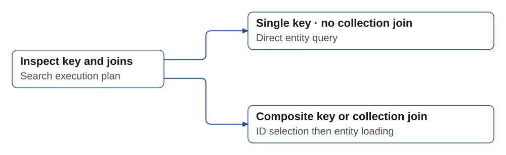

# Two-Phase Query Optimization

The `2.0.0-SNAPSHOT` service chooses a query strategy from entity keys and the paths used by filters, sorts and fetches. Two-phase execution is not mandatory for every search.

## Strategy selection

| Query shape | Execution |
| --- | --- |
| Single primary key; no to-many path | Direct pageable entity query, with eligible to-one fetches |
| Filter, sort or fetch crosses a to-many relation | Page root IDs, then load matching entities |
| Composite primary key | Composite-key ID paging, then entity loading |
| `findFirstWithSearch` | At most one ID plus its entity fetch; no total-count query |

A collection fetch in a pageable entity query can multiply SQL rows and cause in-memory paging. Paging root IDs first avoids that problem. The later entity query has an ID restriction and no pagination clause. A direct query avoids the extra ID round trip where row multiplication is absent.

## ID selection, counts and loading

1. Select keys that match the conditions, in requested order with primary-key tie-breakers. Apply offset and page size to this query.
2. Determine the total. A short, nonempty page establishes the total as offset plus result size. An empty first page establishes zero. An empty page beyond the first still needs a count query.
3. Load entities for those keys, with the requested/automatic fetch paths, in bounded ID batches. Restore the ID query's order in memory because an IN predicate does not preserve it.

The distinct total uses an EXISTS-filtered root count for the two-phase path. It does not concatenate composite ID values, so different keys containing the same delimiter cannot collide. Query counts vary with count inference, key batches and independent collection fetches; there is no universal three-query guarantee.

## Sorting to-many paths

When a filter or sort needs a to-many join in the ID query, grouping ensures one selected row per root key. Ascending sort uses the least related value and descending sort the greatest related value for grouped expressions. Rows excluded by the filter do not contribute to that grouped result. Root-only/to-one ID queries avoid unnecessary GROUP BY and aggregate sorting.

Null ordering and collation follow the database. Add indexes that match your actual filters and sort order, and inspect the database execution plan. A deterministic tie-breaker prevents unstable ordering among equal values; it does not freeze a dataset while other transactions insert or update rows.

## Collections and transactions

Independent collection fetch paths are loaded separately within the service's read transaction. This avoids a Cartesian product across those collections and Hibernate's multiple-bag restriction for independent roots. Paths sharing a first collection are grouped together; deeply nested bag combinations may still need explicit application queries.

Automatic collection-related detection remains enabled for compatibility. Set `searchable.hibernate.auto-fetch-collections=false` to omit those automatic paths, then request required collections explicitly. Existing caller transactions are reused. The library does not change their isolation level; concurrent changes between ID, count and entity queries can still be visible under the database's isolation rules.

## Large result sets

Page size defaults to 20, maximum to 1,000. Offset multiplication is checked before passing an integer offset to JPA. Deep offset pages still cost database work. For an append-only identifier order, an application can use `id.greaterThan=lastId`, `sort=id.asc`, page 0 and a fixed size. That is an application-managed continuation predicate, not a new opaque cursor API; compound sort orders require a corresponding lexicographic predicate.

Avoid selecting large collections simply to render a few summary values. Interface projections are applied to loaded entities, not converted into a column-only SELECT. Use a purpose-built repository query for aggregate reports or a narrow SQL projection.

## Verification

Run `./gradlew performanceTest`. The H2 performance fixtures assert nonempty results and sufficient pagination data; elapsed times are observations, not production latency guarantees. Measure representative data volume, association cardinality, cold/warm cache behavior, query count and execution plans on the deployment database.

[Relationships](./relationship-and-two-phase-query.md) explains filter joins versus fetch joins. [Auto Configuration](./auto-configuration.md) lists controls and resource limits.
