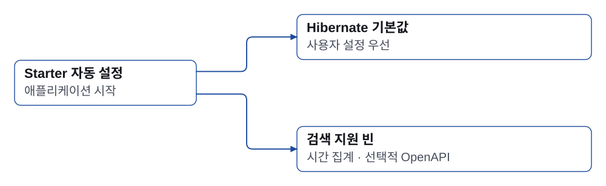

# 자동 설정

starter는 Hibernate 자동 설정 전에 JPA 기본값을 등록하고, Servlet 애플리케이션에 OpenAPI 작업 사용자 정의 구성 요소를 등록합니다. 아래 설정은 모두 선택 사항입니다. 이 문서는 `2.0.0` 기준입니다.

## 설정 예제

```yaml
searchable:
  max-page-size: 1000
  default-page-size: 20
  swagger:
    enabled: true
  date-time:
    default-timezone: Asia/Seoul
  hibernate:
    auto-optimization: true
    auto-fetch-collections: true
    default-batch-fetch-size: 100
    jdbc-batch-size: 1000
    batch-versioned-data: true
    order-inserts: true
    order-updates: true
    in-clause-parameter-padding: true
```

`Asia/Seoul`은 예제의 시간대(timezone)입니다. 기본 시간대는 아래 우선순위에 따라 결정합니다.

## 속성과 제한

| `searchable` 하위 속성 | 기본값 | 동작 |
| --- | --- | --- |
| `default-page-size` | 20 | 검색 조건에 크기가 없을 때 사용합니다. 양수이며 최대값 이하여야 합니다. |
| `max-page-size` | 1000 | 실행할 페이지의 최대 크기입니다. 양수여야 합니다. |
| `swagger.enabled` | true | 라이브러리의 API 문서 사용자 정의 기능을 켭니다. Swagger 접근 제어는 별도입니다. |
| `date-time.default-timezone` | 미지정 | 시간대 없는 입력값을 해석할 때 가장 먼저 확인합니다. |
| `hibernate.auto-optimization` | true | 아래 표의 Hibernate 기본값 여섯 개를 등록합니다. |
| `hibernate.auto-fetch-collections` | true | 직접 연결된 컬렉션 내부의 to-one 경로를 자동 탐지합니다. false이면 이 추가 탐지를 끕니다. |
| `hibernate.default-batch-fetch-size` | 100 | Hibernate 지연 로딩의 배치 크기입니다. 양수여야 합니다. |
| `hibernate.jdbc-batch-size` | 1000 | Hibernate JDBC 명령문의 배치 크기입니다. 양수여야 합니다. |
| `hibernate.batch-versioned-data` | true | Hibernate의 버전 필드 포함 데이터 배치 설정을 전달합니다. |
| `hibernate.order-inserts` | true | JDBC 배치를 위해 INSERT 순서를 조정합니다. |
| `hibernate.order-updates` | true | JDBC 배치를 위해 UPDATE 순서를 조정합니다. |
| `hibernate.in-clause-parameter-padding` | true | IN 파라미터를 패딩해 쿼리 플랜 캐싱을 돕습니다. |

컬렉션 자동 탐지는 기존 로딩 동작을 유지하도록 기본적으로 켜져 있습니다. false로 설정해도 서버에서 명시한 `fetchFields`는 적용합니다. JPA의 `EAGER` 매핑이나 일반 지연 로딩 설정은 변경하지 않습니다.

## Hibernate 기본값과 우선순위

| 라이브러리 속성의 끝부분 | `spring.jpa.properties` 하위 키 |
| --- | --- |
| `default-batch-fetch-size` | `hibernate.default_batch_fetch_size` |
| `jdbc-batch-size` | `hibernate.jdbc.batch_size` |
| `batch-versioned-data` | `hibernate.jdbc.batch_versioned_data` |
| `order-inserts` | `hibernate.order_inserts` |
| `order-updates` | `hibernate.order_updates` |
| `in-clause-parameter-padding` | `hibernate.query.in_clause_parameter_padding` |

자동 등록 값의 우선순위는 가장 낮습니다. 애플리케이션, 시스템 속성, 환경 변수에 명시한 값을 우선합니다. `auto-optimization: false`로 설정하면 이 기본값 등록을 끕니다. 요청 검증, 페이지 제한과 시간대 설정은 계속 적용합니다.

starter는 **`hibernate.connection.provider_disables_autocommit`을 설정하지 않습니다.** 이 속성은 데이터소스가 자동 커밋을 끈 상태로 연결을 제공한다는 보장을 나타냅니다. 보장 없이 true로 강제하면 롤백해야 할 쓰기가 커밋될 수 있습니다. 데이터소스의 자동 커밋과 트랜잭션 설정은 애플리케이션에서 관리하세요.

JDBC 명령문의 배치 크기와 서비스가 엔티티 200건씩 처리하는 단위는 서로 다릅니다. `jdbc-batch-size`를 바꿔도 서비스의 처리 단위나 트랜잭션 경계는 달라지지 않습니다.

## 요청 제한

| 입력 | 제한 |
| --- | --- |
| 페이지 번호 | 0 이상 |
| 페이지 크기 | 1 이상, 설정한 `max-page-size` 이하 |
| 오프셋 | `page * size <= 2,147,483,647` |
| 조건·그룹 노드 | 전체 1,000개 이하 |
| 그룹 깊이 | 루트 목록 아래 중첩 32단계 이하 |
| IN을 포함한 컬렉션 값 | 조건마다 1,000개 이하 |
| 정렬 필드 | 16개 이하 |

JSON 변환, 빌더와 쿼리 구성 단계에서 구조를 검사합니다. DTO를 사용하는 진입점에서는 검색 필드 허용 여부, 연산자, 정렬 허용 여부와 값도 검증합니다. 직접 생성한 `SearchCondition`은 신뢰할 수 있는 서버 코드용입니다. 외부 입력을 받는 DTO 검증을 대신하지 않습니다. HTTP 본문 크기, 문자열 길이, 요청 빈도와 쿼리 시간 제한은 애플리케이션에서 설정하세요.

페이지 기본값과 최대값은 실제 영속성 단위에서 읽습니다. starter를 사용하지 않을 때는 EntityManagerFactory에 `searchable.default_page_size`, `searchable.max_page_size`, `searchable.auto_fetch_collections` 속성을 지정할 수 있습니다. starter는 `spring.jpa.properties`를 통해 전달합니다. 별도 영속성 단위를 구성할 때는 속성을 직접 전달하세요. 페이지 설정값은 양수이며 기본값이 최대값 이하여야 합니다.

## 시간대 결정 순서

1. 유효한 `searchable.date-time.default-timezone` 값
2. `applicationZoneId`라는 이름의 `ZoneId` 빈
3. 유효한 `spring.jackson.time-zone` 값
4. UTC

시간대 ID가 잘못되면 로그를 기록하고 다음 설정을 확인합니다. 검색값에 지정한 오프셋은 해석에 반영합니다. 시간대 없는 날짜·시간과 날짜만 지정한 BETWEEN 경계에는 애플리케이션 시간대를 적용합니다. 파서의 시간대 보관 객체는 프로세스 전체에서 공유하므로 한 JVM에서 여러 애플리케이션 컨텍스트를 실행하면 같은 시간대를 사용하세요. 페이지 제한은 전역으로 공유하지 않습니다.

## 등록하는 빈

애플리케이션에 같은 타입의 빈이 없으면 `TimeBucketCounter`를 등록합니다. `searchConditionCustomizer`는 Swagger 사용자 정의 기능이 켜져 있고, Spring MVC의 `RequestMappingHandlerMapping`과 SpringDoc 클래스가 있는 Servlet 애플리케이션에 등록합니다. 같은 이름의 애플리케이션 빈이 있으면 그 빈을 사용합니다.



그룹별 API 설정은 [OpenAPI 통합](./openapi-integration.md), 연관 데이터 로딩은 [관계형 데이터](./relationship-and-two-phase-query.md)를 참조하세요.
