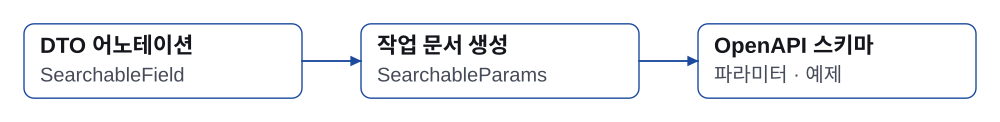

# OpenAPI 통합

starter에는 OpenAPI 모듈과 Boot 4용 SpringDoc 2.10.0이 포함됩니다. Boot 3 유지보수 계열은 SpringDoc 2.x를 사용합니다. 애플리케이션의 Boot 버전과 호환되는 SpringDoc 계열을 유지하세요.

## GET 문서

```java
import dev.simplecore.searchable.openapi.annotation.SearchableParams;
import java.util.Map;
import org.springframework.web.bind.annotation.RequestParam;

// On a controller method parameter:
// @RequestParam @SearchableParams(PostSearchDTO.class) Map<String, String> params
```

`ParameterGenerator`는 DTO 검색 필드마다 허용한 연산자의 쿼리 파라미터를 추가합니다. 연산자 선언이 비어 있으면 필드의 연산을 숨기지 않고 모든 연산자를 문서에 표시합니다. 상속한 검색 필드도 포함합니다. 정렬 설명에는 정렬 가능한 필드를 표시하고 page·size 파라미터를 추가합니다. 어노테이션은 입력 문서만 생성하므로 실제 변환에는 [기본 사용법](./basic-usage.md)의 `SearchableParamsParser.convert`를 호출하세요.

## POST 문서

`@RequestBody SearchCondition<PostSearchDTO>`를 사용하세요. 사용자 정의 구성 요소는 타입 인자를 확인해 조건·그룹 스키마와 JSON 예제를 생성합니다. 타입 인자 없는 `SearchCondition`, 와일드카드나 확인할 수 없는 제네릭 타입에는 생성 정보가 부족할 수 있습니다. 컨트롤러 경계에 구체 DTO 타입을 선언하세요.

예제 생성기는 검색 필드와 허용 연산자를 선택하고, 가능한 경우 DTO 스키마 예제값을 대상 타입으로 변환합니다. 생성 오류는 로그에 기록하며 빈 예제가 생성될 수 있습니다. 문서 생성 오류가 허용하지 않은 필드의 실행 권한을 추가하지는 않습니다. 사용자 정의 검증 제약을 쓰면 생성된 예제도 확인하세요.

## 설명과 값 스키마

Swagger 필드 어노테이션으로 설명·예제를 지정할 수 있습니다.

```java
import dev.simplecore.searchable.core.annotation.SearchableField;
import io.swagger.v3.oas.annotations.media.Schema;
import static dev.simplecore.searchable.core.condition.operator.SearchOperator.CONTAINS;

public class TitleSearchDTO {
    @SearchableField(operators = {CONTAINS})
    @Schema(description = "Post title", example = "Spring")
    private String title;
    public String getTitle() { return title; }
}
```

날짜·시간 파라미터는 date, partial-time, date-time 형식을 구분합니다. 여러 값을 받는 GET 파라미터는 쉼표로 구분한 문자열이며 enum 값 안내도 유지합니다. 배열과 상속 필드도 처리합니다. 스키마 예제는 문서용 안내이며 권한이나 검증을 대신하지 않습니다.

## 자동 설정과 그룹

`searchConditionCustomizer` 빈은 `OperationCustomizer` 타입입니다. 필요한 SpringDoc·Spring MVC 빈이 있는 Servlet 애플리케이션에서 기본적으로 켜집니다. 같은 이름의 빈을 정의해 바꾸거나 다음 설정으로 끌 수 있습니다.

```yaml
searchable:
  swagger:
    enabled: false
```

Searchable JPA의 문서 사용자 정의만 끄며 SpringDoc의 API 엔드포인트는 끄지 않습니다. 엔드포인트를 비활성화하려면 별도로 설정하세요.

```yaml
springdoc:
  api-docs:
    enabled: false
  swagger-ui:
    enabled: false
```

그룹을 직접 구성한다면 해당 그룹에 작업 사용자 정의 구성 요소를 추가하세요.

```java
import org.springdoc.core.customizers.OperationCustomizer;
import org.springdoc.core.models.GroupedOpenApi;
import org.springframework.beans.factory.annotation.Qualifier;
import org.springframework.context.annotation.Bean;

@Bean
GroupedOpenApi postsApi(@Qualifier("searchConditionCustomizer") OperationCustomizer customizer) {
    return GroupedOpenApi.builder().group("posts")
            .pathsToMatch("/api/posts/**")
            .addOperationCustomizer(customizer)
            .build();
}
```

파라미터가 중복되지 않도록 그룹마다 한 번만 등록하세요. 현재 설명 생성기는 작업 설명을 검색 필드 요약으로 교체합니다. 추가 API 설명은 별도 위치에 작성하거나 후속 사용자 정의 구성 요소에서 명시적으로 처리하세요.



## 실행 결과 확인

SpringDoc 기본 경로에서는 `/v3/api-docs`와 `/swagger-ui/index.html`을 확인하세요. 그룹별 설명은 `/v3/api-docs/{group}`에 있습니다. 별칭, 상속 필드, 허용 연산자, 날짜·시간 형식과 예제값을 확인하세요. Swagger에는 일반적인 페이지 예제를 표시하며, 실제 최대 크기는 애플리케이션 설정으로 결정합니다. 기본값과 다른 최대값을 사용한다면 스키마도 그에 맞게 조정하세요.

라이브러리는 문서 엔드포인트의 인증 정책이나 애플리케이션의 오류·응답 DTO 규약을 자동으로 정의하지 않습니다. 애플리케이션에서 구성하세요. OpenAPI 설명은 서버의 DTO 검증을 대신하지 않습니다.
