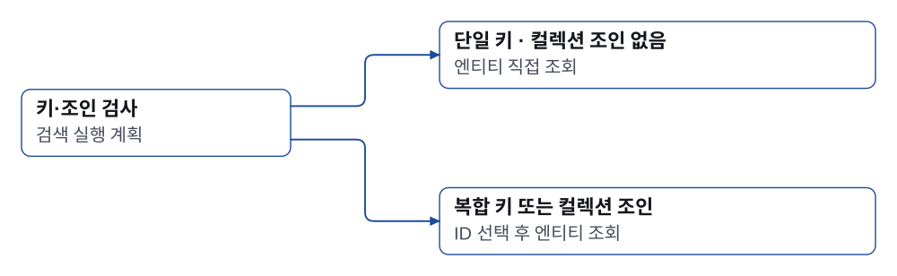

# 2단계 쿼리 최적화

`1.1.4-SNAPSHOT` 서비스는 엔티티 기본키와 검색·정렬·로딩 경로에 따라 조회 방식을 선택합니다. 모든 검색에 2단계 조회를 적용하지는 않습니다.

## 조회 방식 선택

| 쿼리 형태 | 실행 방식 |
| --- | --- |
| 단일 기본키이며 to-many 경로가 없음 | 필요한 to-one fetch를 포함한 직접 페이지 조회 |
| 검색·정렬·fetch가 to-many 관계를 통과함 | 루트 ID의 페이지 조회 후 엔티티 로딩 |
| 복합 기본키 | 복합키의 페이지 조회 후 엔티티 로딩 |
| `findFirstWithSearch` | ID 최대 1개와 해당 엔티티 조회, 전체 건수 조회 생략 |

컬렉션 fetch를 포함한 엔티티 쿼리에 페이지를 적용하면 SQL 행이 늘어나 메모리에서 페이지를 나눌 수 있습니다. 루트 ID를 먼저 조회하면 이 문제를 피할 수 있습니다. 이후 엔티티 쿼리는 ID로 범위를 제한하며 페이지 조건을 적용하지 않습니다. 행이 늘어나지 않는 조회에는 직접 페이지 쿼리를 사용해 ID 조회 왕복을 줄입니다.

## ID 선택·건수·로딩

1. 검색 조건을 만족하는 키를 정렬하고, 같은 값의 순서를 결정할 기본키 정렬을 추가합니다. 이 쿼리에 오프셋과 페이지 크기를 적용합니다.
2. 전체 건수를 결정합니다. 비어 있지 않은 마지막 페이지라면 오프셋과 결과 수를 합합니다. 첫 페이지가 비어 있으면 0입니다. 첫 페이지 이후의 빈 페이지는 건수 조회가 필요합니다.
3. ID를 나누어 엔티티와 명시적·자동 fetch 경로를 조회합니다. IN 조건은 ID 순서를 보장하지 않으므로 메모리에서 ID 조회 순서로 복원합니다.

2단계 경로의 전체 건수는 EXISTS로 조건을 만족하는 루트를 세어 계산합니다. 복합키 값을 문자열로 연결하지 않으므로 구분자가 같은 서로 다른 키가 충돌하지 않습니다. 건수 추론, ID 배치 수와 독립된 컬렉션 수에 따라 쿼리 수가 달라집니다. 항상 쿼리 세 번만 실행한다고 보장하지 않습니다.

## To-many 경로 정렬

ID 조회의 검색·정렬에 to-many 조인이 필요하면 기본키별로 그룹화해 루트마다 한 행을 선택합니다. 그룹화된 정렬식은 오름차순일 때 연관 값의 최소값, 내림차순일 때 최대값을 사용합니다. 검색 조건에서 제외된 행은 그룹 계산에 포함되지 않습니다. 루트 속성이나 to-one 경로만 사용하는 ID 조회에서는 불필요한 GROUP BY와 집계 정렬을 생략합니다.

NULL 정렬 순서와 문자열 정렬 규칙은 데이터베이스 설정을 따릅니다. 실제 검색·정렬 조건에 맞는 인덱스를 만들고 실행 계획을 확인하세요. 기본키 정렬은 같은 값의 순서를 결정하지만, 다른 트랜잭션이 데이터를 추가·변경하는 동안 전체 검색 결과를 고정하지는 않습니다.

## 컬렉션과 트랜잭션

서비스의 읽기 트랜잭션 안에서 독립된 컬렉션 경로를 각각 조회합니다. 이 방식은 컬렉션 간 조합으로 행이 늘어나는 문제와 독립된 bag 컬렉션의 동시 fetch 제약을 줄입니다. 첫 컬렉션 경로가 같은 fetch는 함께 처리하므로 깊이 중첩된 bag 조합에는 애플리케이션의 별도 쿼리가 필요할 수 있습니다.

호환성을 위해 컬렉션 내부의 연관 경로 자동 탐지는 기본적으로 켜져 있습니다. `searchable.hibernate.auto-fetch-collections=false`로 끈 뒤 필요한 컬렉션을 명시할 수 있습니다. 호출자가 시작한 트랜잭션은 그대로 사용하며 격리 수준을 바꾸지 않습니다. 데이터베이스 격리 수준에 따라 ID·건수·엔티티 조회 사이에 다른 트랜잭션의 변경이 보일 수 있습니다.

## 대량 결과 처리

기본 페이지 크기는 20, 최대 크기는 1,000입니다. JPA에 정수 오프셋을 전달하기 전에 곱셈 결과를 검사합니다. 큰 오프셋의 페이지는 여전히 데이터베이스 처리 비용이 듭니다. ID가 증가하는 순서라면 애플리케이션에서 `id.greaterThan=lastId`, `sort=id.asc`, 페이지 0과 고정 크기를 조합할 수 있습니다. 이는 애플리케이션이 관리하는 후속 검색 조건이며 별도의 커서 API가 아닙니다. 복합 정렬에는 그 순서에 맞는 사전식 비교 조건이 필요합니다.

요약값 몇 개를 표시하려고 큰 컬렉션 전체를 조회하지 마세요. 인터페이스 프로젝션은 로딩한 엔티티에 적용하며, 필요한 열만 SELECT하는 방식은 아닙니다. 집계 보고서나 일부 열만 필요한 경우에는 전용 Repository 쿼리를 사용하세요.

## 검증

`./gradlew performanceTest`를 실행하세요. H2 성능 테스트는 결과가 비어 있지 않고 페이지 검증에 필요한 데이터가 있는지 검사합니다. 측정 시간은 테스트 관측값이며 운영 응답 시간을 보장하지 않습니다. 운영 데이터베이스에서 실제 데이터량, 연관 데이터 수, 캐시 상태, 쿼리 수와 실행 계획을 확인하세요.

검색 조인과 fetch 조인의 차이는 [관계형 데이터](./relationship-and-two-phase-query.md), 설정과 요청 제한은 [자동 설정](./auto-configuration.md)을 참조하세요.
